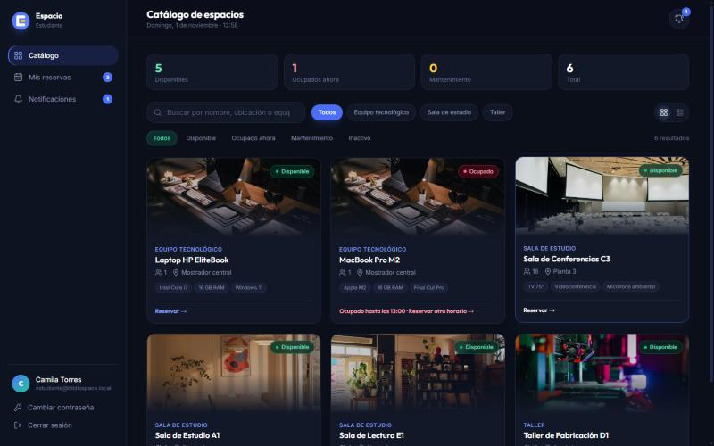
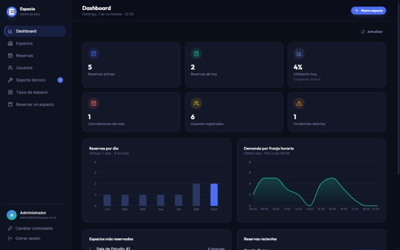

# Espacia — Backend

API REST para reservar salas de estudio, equipos y talleres de una biblioteca.
Spring Boot 4 · Java 25 · Spring Security + JWT · PostgreSQL.

El frontend está en el repositorio [Espacia-Frontend](https://github.com/Sebxx66/Espacia-Frontend).

## Vista previa

La interfaz completa está en el repositorio del frontend.

| Catálogo de espacios | Panel del administrador |
|---|---|
|  |  |

## Funciones

- Registro e inicio de sesión con roles (estudiante, funcionario y administrador).
- Catálogo de espacios con ocupación en tiempo real y reservas sin choques de horario.
- Reglas de reserva configurables en código: horario, duración, reservas activas y límite diario.
- Correos automáticos: bienvenida, confirmación, cancelación o anulación, recordatorio antes de la reserva y recuperación de contraseña.
- Notificaciones dentro de la aplicación, incidencias de soporte técnico y panel de estadísticas.
- Protección contra abuso: bloqueo temporal tras varios intentos fallidos de inicio de sesión y límite de solicitudes de recuperación de contraseña.

## Requisitos

- Java 25
- Docker Desktop (para la base de datos), o un PostgreSQL propio

## Puesta en marcha

1. Levanta la base de datos (los datos se guardan en el volumen `bibliospace-data`):

   ```bash
   docker compose up -d
   ```

2. Arranca el backend en `http://localhost:8080`:

   ```bash
   ./mvnw spring-boot:run
   ```

   En Windows: `mvnw.cmd spring-boot:run`.

Al primer arranque se crean automáticamente:

- **Un administrador** (si no existe ninguno): `admin@bibliospace.local` con contraseña `Admin12345`.
  Cámbiala desde la aplicación o define `ADMIN_EMAIL` y `ADMIN_PASSWORD` antes de arrancar.
- **Datos de demostración** (desactívalos con `SEED_DEMO_DATA=false`): seis espacios de ejemplo, dos estudiantes, un funcionario, reservas de las últimas semanas, incidencias y notificaciones.

### Cuentas de demostración

| Rol | Correo | Contraseña |
|---|---|---|
| Estudiante | `estudiante@bibliospace.local` | `Demo12345` |
| Funcionario | `funcionario@bibliospace.local` | `Demo12345` |
| Administrador | `admin@bibliospace.local` | `Admin12345` |

Son solo para desarrollo. En un entorno real desactiva los datos de demostración y cambia las credenciales.

## Correo electrónico

Sin configurar nada, la aplicación funciona igual y registra en el log los correos que habría enviado.
Para enviarlos de verdad define `MAIL_USERNAME` y `MAIL_PASSWORD`. Con Gmail usa una
[contraseña de aplicación](https://support.google.com/accounts/answer/185833), no la contraseña normal de la cuenta.
Para un uso real conviene un proveedor transaccional (Brevo, Resend, Amazon SES) con tu propio dominio.

## Pruebas automáticas

```bash
./mvnw test
```

Usan una base de datos H2 en memoria, así que no necesitan Docker. Levantan el backend completo y lo llaman por HTTP para cubrir registro e inicio de sesión, bloqueo por intentos fallidos, permisos por rol, las reglas de reserva y las reservas simultáneas. En GitHub se ejecutan solas en cada push (`.github/workflows/ci.yml`).

## Configuración

Todo se configura con variables de entorno; los valores por defecto coinciden con `docker-compose.yml`.

| Variable | Por defecto | Uso |
|---|---|---|
| `DB_URL` | `jdbc:postgresql://localhost:5432/bibliospace_db` | Conexión a PostgreSQL |
| `DB_USERNAME` | `postgres` | Usuario de la base de datos |
| `DB_PASSWORD` | `bibliospace` | Contraseña de la base de datos (también la usa `docker compose`) |
| `JWT_SECRET` | valor de desarrollo | Clave para firmar los tokens (mínimo 32 caracteres). **Cámbiala en producción** |
| `CORS_ALLOWED_ORIGINS` | `localhost` y `127.0.0.1` en los puertos 5173 y 8443 | Orígenes del frontend, separados por coma |
| `FRONTEND_URL` | `http://localhost:8443` | Dirección del frontend, usada en los enlaces de los correos |
| `ADMIN_NOMBRE`, `ADMIN_EMAIL`, `ADMIN_PASSWORD` | ver arriba | Administrador inicial |
| `SEED_DEMO_DATA` | `true` | Crear datos de demostración |
| `SEED_DEMO_PASSWORD` | `Demo12345` | Contraseña de las cuentas de demostración |
| `MAIL_USERNAME`, `MAIL_PASSWORD` | vacío | Cuenta SMTP. Sin ellas el envío queda desactivado |
| `MAIL_HOST`, `MAIL_PORT`, `MAIL_FROM_NAME` | `smtp.gmail.com`, `587`, `Espacia` | Servidor SMTP y nombre del remitente |
| `REMINDER_MINUTES` | `60` | Minutos antes del inicio en que se envía el recordatorio |

## Roles

| Rol | Puede |
|---|---|
| Estudiante (`ROLE_ESTUDIANTE`) | Registrarse, ver el catálogo, reservar, cancelar, extender y ver sus notificaciones |
| Funcionario (`ROLE_FUNCIONARIO`) | Lo anterior, más validar llegadas, registrar devoluciones, ver todas las reservas y gestionar incidencias |
| Administrador (`ROLE_ADMIN`) | Todo lo anterior, más el dashboard, la gestión de espacios y la de usuarios |

El registro público siempre crea estudiantes. Las cuentas de funcionario y administrador las crea un administrador.

## Reglas de reserva

- Horario de 08:00 a 20:00, máximo 4 horas por reserva.
- Máximo 3 reservas activas por usuario y hasta 30 días de anticipación.
- Máximo 1 equipo tecnológico y 2 salas o talleres por usuario y por día.
- Cancelación hasta 1 hora antes del inicio. Extensión de 1 hora si el espacio está libre.
- No se permiten reservas superpuestas en un mismo espacio.
- Si un espacio pasa a mantenimiento o inactivo, sus reservas futuras se anulan y se notifica a los usuarios.
- Las contraseñas deben tener al menos 8 caracteres.
- Tras 5 contraseñas incorrectas seguidas, la cuenta se bloquea 15 minutos. La recuperación de contraseña admite 3 solicitudes por hora por correo.

## API

Todas las rutas empiezan por `/api/v1`. Los errores responden `{"message": "..."}`.

| Método y ruta | Rol | Descripción |
|---|---|---|
| `POST /auth/register` · `POST /auth/login` | Público | Registro (estudiante) e inicio de sesión. Devuelven el token JWT |
| `POST /auth/forgot-password` · `POST /auth/reset-password` | Público | Recuperación de contraseña por correo (el enlace vence en 60 minutos y se usa una sola vez) |
| `GET /auth/me` · `PATCH /auth/password` | Autenticado | Datos propios y cambio de contraseña |
| `GET /spaces` · `GET /spaces/{id}` | Autenticado | Catálogo, con ocupación en tiempo real |
| `GET /spaces/{id}/availability?fecha=` | Autenticado | Horarios ocupados de un día |
| `POST /spaces` · `PUT /spaces/{id}` · `DELETE /spaces/{id}` | Admin | Gestión de espacios |
| `POST /reservations` · `GET /reservations/me` | Autenticado | Crear y listar reservas propias |
| `PATCH /reservations/{id}/cancel` · `/extend` | Dueño | Cancelar o extender 1 hora |
| `GET /reservations?estado=&fecha=` | Funcionario, admin | Todas las reservas |
| `PATCH /reservations/{id}/check-in` · `/finish` · `/reject` | Funcionario, admin | Validar llegada, finalizar o devolver, anular |
| `GET /notifications/me` · `PATCH /notifications/{id}/read` · `/read-all` | Autenticado | Notificaciones |
| `GET /users` · `POST /users` · `PATCH /users/{id}` · `PATCH /users/{id}/password` | Admin | Gestión de usuarios |
| `GET /incidents` · `POST /incidents` · `PATCH /incidents/{id}/resolve` | Funcionario, admin | Soporte técnico |
| `GET /admin/dashboard` | Admin | Estadísticas |
